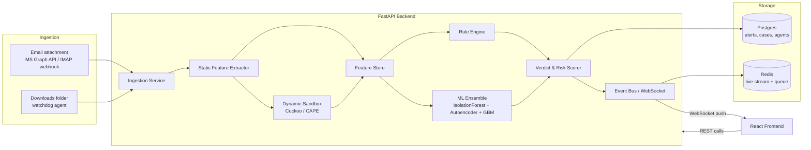

# Zero Minus One — Backend Architecture & Build Guide

Your frontend (`ZeroMinusOne`) is a React/Vite/Express app that currently runs entirely on **mock data** generated inside `SecurityContext.tsx`, with one real backend call (`/api/ai-explain`, Gemini-powered). The `types.ts` file already defines the exact shape of a real EDR backend: `ThreatAlert` with `ruleScore` + `mlScore` + `autoencoderLoss`, `MailItem` with `sandboxStatus`, `AgentDevice`, `FeatureValue`, `ProcessNode`. That's a strong signal of what the backend needs to actually produce.

This guide gives you: the architecture, which models to use and why, how to simulate "live" behavior for your demo/viva, the API contract that matches your existing frontend types, and a master prompt to hand to the GitHub Copilot Agent.

---

## 1. High-level architecture



**Why this shape:** your UI already expects a *rule score*, an *ML score*, and an *autoencoder loss* per alert (`ThreatAlert.ruleScore / mlScore / autoencoderLoss`), combined into one `riskScore`. So the backend isn't "one model" — it's a small **ensemble pipeline**, which also happens to be the academically correct way to frame zero-day detection (signature/rule layer catches known bad, ML layer catches "looks like malware", autoencoder layer catches "looks abnormal even if we've never seen it").

---

## 2. Which models to use, and why

| Layer | Purpose | Model | Trained on | Populates |
|---|---|---|---|---|
| **Rule engine** | Catch known-bad fast (hashes, signed/unsigned, YARA-style string/pattern rules, known LOTL binaries e.g. `powershell.exe -enc`) | Deterministic rules, no ML | MITRE ATT&CK technique list + your own rule set | `ruleScore`, `rules[]` |
| **Static ML classifier** | "Does this file's structure look like malware" (before execution) | **Gradient-boosted trees** (LightGBM/XGBoost) on PE/static features, OR the pretrained **EMBER** LightGBM model | **EMBER** dataset (2.4M labeled PE files, static features already extracted for you — you don't need to hand-engineer these) | contributes to `mlScore` |
| **Anomaly / zero-day layer** | Catch behavior nobody has labeled before | **Autoencoder** (small feed-forward NN) trained only on *benign* behavior; high reconstruction error = anomalous. Alternative/companion: **Isolation Forest** on the same feature vector (cheaper, no GPU needed, good baseline) | Your own benign telemetry baseline (start with **CICIDS2017** for network-flow features, plus benign runs from your own sandbox) | `autoencoderLoss`, and Isolation Forest's anomaly score also folds into `mlScore` |
| **Sequence behavior model** *(stretch goal, matches your blueprint)* | Model the *order* of syscalls/API calls a process makes over time, not just a snapshot | **LSTM/GRU** classifier over the Cuckoo/CAPE API-call sequence | Cuckoo sandbox run logs (label benign vs malicious runs) | feeds into `mlScore`, and is what makes `ProcessNode.isAnomalous` explainable |
| **Explainability** | Turn the above into `explainability.summary/detailedExplanation/keyIndicators` | You already have this — Gemini via `/api/ai-explain`. Feed it the rule hits + top-Z-score features instead of writing this yourself | n/a | `explainability` |

**Practical sequencing advice (don't build all 4 at once):**
1. Start with **rules + Isolation Forest** on static features (EMBER-style). This alone gets you a working, demoable pipeline in week 1–2.
2. Add the **autoencoder** (it's what justifies calling this "zero-day" detection in your report — it's the one that doesn't need labeled malware).
3. Add the **LSTM/GRU on sandbox sequences** last — it's the most work (needs Cuckoo running) and is your "advanced" section for the viva. GNN over the process tree is a good "future work" line if you run out of time — don't force it into the working prototype.

`riskScore` formula (matches your `ThresholdSettings.ruleWeightRatio` / `mlWeightRatio` fields, which already exist in `types.ts`):
```
riskScore = (ruleScore * ruleWeightRatio) + (mlScore * mlWeightRatio) + normalize(autoencoderLoss) * 100
```

---

## 3. Ingestion: how files actually reach the backend

You said "files from email or downloads" — two different pipelines:

- **Email attachments:** don't try to build a mail server. Use **Microsoft Graph API** (you already use M365/Defender at work, so this will feel familiar) subscribed to new-mail webhooks on a mailbox, or poll `/me/messages` for attachments. Download the attachment bytes → send into the same ingestion pipeline as downloads. This is also literally what your `MailSecurityScreen` / `MailItem` type already models (`sandboxStatus: 'ANALYZING' | 'DETONATED'`).
- **Downloads folder:** a lightweight **agent** (Python script using `watchdog` on the folder, or a Windows service) that detects new files, computes a SHA-256, and POSTs metadata + the file to your backend's `/api/ingest` endpoint.

Both paths converge on one endpoint, so your ML pipeline doesn't care where the file came from — only `MailItem` vs generic `ThreatAlert.entity` differs on the frontend side.

---

## 4. Simulating "live" behavior (what you asked for specifically)

You don't need real malware flowing through the system to demo it convincingly — and for a student project you *shouldn't* be routing live malicious samples through your own machine anyway. Build a **Simulation Service** that is a first-class part of the backend, not a hack:

- A `/api/simulate/start` endpoint that plays back a **scripted sequence of events** (a JSON fixture list of `ThreatAlert`, `MailItem`, `AgentDevice` status changes) at realistic time intervals, pushed over WebSocket — this directly replaces the client-side mock-data timer logic currently living in `SecurityContext.tsx`.
- Use a handful of genuinely safe test artifacts to make the "when it's on" demo real instead of purely scripted:
  - **EICAR test file** — an industry-standard, completely harmless string that every AV engine is designed to flag as a test virus. Great for proving your rule engine actually fires on a real file.
  - A small set of benign files (PDFs, images, plain `.exe` hello-world builds you compile yourself) to prove the pipeline returns "clean" correctly, not just "everything is a threat."
  - A couple of PowerShell scripts that do LOTL-style but harmless things (list processes, query registry) to demonstrate behavioral rule hits without any real payload.
- Architecturally: `SIMULATION_MODE=true` env var switches the ingestion source from "real files" to "the scripted fixture generator," while every downstream stage (rules → ML → risk scoring → WebSocket push → frontend) runs for real. That's the honest way to say "I simulated the workflow" in your report — the detection logic isn't faked, only the sample supply is.

---

## 5. API contract (matches your existing `types.ts` — don't change the frontend)

```
GET    /api/health
POST   /api/ingest                      # file upload (email or download source), returns { alertId }
GET    /api/alerts                      # -> ThreatAlert[]
GET    /api/alerts/:id                  # -> ThreatAlert (with processTree, features, explainability)
PATCH  /api/alerts/:id/status           # isolate / dismiss / resolve
GET    /api/mail                        # -> MailItem[]
GET    /api/agents                      # -> AgentDevice[]
GET    /api/quarantine                  # -> QuarantineItem[]
POST   /api/quarantine/:id/restore
GET    /api/cases                       # -> InvestigationCase[]
GET    /api/attck-coverage              # -> ATTACKTechnique[]
GET    /api/settings/thresholds         # -> ThresholdSettings
PUT    /api/settings/thresholds
POST   /api/ai-explain                  # already exists — keep as is
POST   /api/simulate/start
POST   /api/simulate/stop
WS     /ws/live                          # pushes new ThreatAlert / MailItem / AgentDevice events
```

Keep `/api/ai-explain` exactly where it is in `server.ts` — everything else is new. You can either extend the existing Express server with these routes (fastest, no new stack to learn) **or** run a separate Python FastAPI service for the ML-heavy routes (`/api/ingest`, `/api/alerts`) and keep Express only for the frontend + `/api/ai-explain`, proxying `/api/*` calls it doesn't own to FastAPI. For a project centered on ML, I'd recommend the second: Python has the actual ML ecosystem (scikit-learn, PyTorch, LightGBM); don't fight Node for that part.

---

## 6. Suggested repo structure

```
zero-minus-one/
├── frontend/                  # your existing React app, unchanged
├── backend/
│   ├── app/
│   │   ├── main.py            # FastAPI entrypoint
│   │   ├── routes/
│   │   │   ├── ingest.py
│   │   │   ├── alerts.py
│   │   │   ├── mail.py
│   │   │   ├── agents.py
│   │   │   └── simulate.py
│   │   ├── pipeline/
│   │   │   ├── static_features.py     # PE header / entropy / import table extraction
│   │   │   ├── rule_engine.py         # YARA-style + LOTL rules
│   │   │   ├── ml_isolation_forest.py
│   │   │   ├── ml_autoencoder.py
│   │   │   ├── ml_sequence_lstm.py    # stretch goal
│   │   │   └── risk_scorer.py
│   │   ├── sandbox/
│   │   │   └── cuckoo_client.py       # talks to a Cuckoo/CAPE instance
│   │   ├── ingestion/
│   │   │   ├── graph_mail_watcher.py  # MS Graph API polling
│   │   │   └── download_watcher.py    # watchdog agent
│   │   ├── ws/
│   │   │   └── live_bus.py            # WebSocket broadcaster
│   │   ├── db/
│   │   │   ├── models.py              # SQLAlchemy models mirroring types.ts
│   │   │   └── session.py
│   │   └── simulation/
│   │       ├── fixtures/              # scripted JSON event sequences
│   │       └── player.py
│   ├── models/                        # saved .joblib / .pt model weights
│   ├── training/
│   │   ├── train_isolation_forest.py
│   │   ├── train_autoencoder.py
│   │   └── train_lstm.py
│   ├── requirements.txt
│   └── Dockerfile
└── docker-compose.yml                 # postgres, redis, backend, cuckoo (optional)
```

---

## 7. Build order (realistic phasing for a final-year project timeline)

1. **Phase 1 — Wire it up (no ML yet):** FastAPI skeleton, Postgres models matching `types.ts`, `/api/alerts` returning data from DB instead of frontend mock, WebSocket push. Point the frontend at it. This alone proves the architecture works end-to-end.
2. **Phase 2 — Static analysis + rule engine:** file upload → SHA-256 + PE feature extraction (use `pefile` and/or `lief` in Python) → rule hits → a real `ruleScore`.
3. **Phase 3 — Isolation Forest on EMBER features:** train offline on the EMBER dataset, save the model, load it at inference time → real `mlScore`.
4. **Phase 4 — Autoencoder anomaly layer:** train on benign-only feature vectors → `autoencoderLoss`.
5. **Phase 5 — Simulation service:** scripted fixture player + EICAR/benign-file demo path, as in section 4.
6. **Phase 6 (stretch) — Cuckoo sandbox + LSTM sequence model:** dynamic analysis, `MailItem.sandboxStatus`, process-tree building for `ProcessNode`.
7. **Phase 7 — Ingestion agents:** MS Graph mail watcher, downloads-folder watcher, so the demo can run on genuinely new files instead of only the simulation fixtures.

---

## 8. Master prompt for GitHub Copilot Agent

Paste this as-is into Copilot Agent inside your project (it references the actual file names above, so keep this guide in the repo — e.g. as `docs/BACKEND_PLAN.md` — and point the agent at it):

```
You are working inside the ZeroMinusOne repo. The frontend already exists at /frontend
(React + Vite + TS, see /frontend/src/types.ts for the full data model, and
/frontend/src/context/SecurityContext.tsx for the mock data it currently runs on).
Do not modify the frontend's component files or types.ts unless I explicitly ask.

Build a new /backend service per docs/BACKEND_PLAN.md:

1. Scaffold a FastAPI app under /backend/app with the route files, pipeline modules,
   db models, and simulation module listed in the repo structure section of
   docs/BACKEND_PLAN.md. Use SQLAlchemy + Postgres, with models that mirror the
   TypeScript interfaces in /frontend/src/types.ts field-for-field (ThreatAlert,
   MailItem, AgentDevice, QuarantineItem, InvestigationCase, ATTACKTechnique,
   ThresholdSettings).

2. Implement Phase 1 first: working CRUD + WebSocket broadcast on /ws/live, with the
   REST endpoints listed in the "API contract" section, backed by the DB instead of
   mock data. Add a docker-compose.yml with postgres, redis, and the backend service.

3. Implement the rule engine (app/pipeline/rule_engine.py) as a small set of Python
   functions returning (score, matched_rules: list[str]) given file metadata + static
   features — start with: unsigned executable, LOTL binary + encoded PowerShell
   command line, mismatched file extension vs magic bytes, high Shannon entropy
   (>7.2) suggesting packing.

4. Implement static feature extraction (app/pipeline/static_features.py) using the
   `pefile` and `lief` Python libraries: import table, section entropy, header
   fields, in a flat feature vector suitable for scikit-learn.

5. Implement app/pipeline/ml_isolation_forest.py: a scikit-learn IsolationForest
   wrapper with load/predict methods, and a separate training/train_isolation_forest.py
   script that trains on a feature CSV (I will supply an EMBER-derived feature CSV
   separately — stub the loader to read from /backend/training/data/ember_features.csv).

6. Implement app/pipeline/ml_autoencoder.py: a small PyTorch feed-forward autoencoder
   (input dim = same feature vector size as the Isolation Forest), with a
   training/train_autoencoder.py script trained on benign-only rows, and a
   reconstruction-error method used at inference.

7. Implement app/pipeline/risk_scorer.py combining rule_score, ml_score
   (Isolation Forest anomaly score, normalized 0-100), and autoencoder_loss
   (normalized 0-100) into a single riskScore using configurable weights that match
   ThresholdSettings.ruleWeightRatio / mlWeightRatio.

8. Implement app/simulation/player.py + a POST /api/simulate/start /
   POST /api/simulate/stop route pair: reads JSON event fixtures from
   app/simulation/fixtures/, and replays them onto the same WebSocket bus used by
   real ingestion, at randomized realistic intervals (5-30s apart). Generate 3-4
   example fixture files covering a clean scan, a known-malware detection, a
   zero-day/behavioral anomaly detection, and a malicious mail attachment.

9. Wire /api/ingest to accept a file upload, run it through static_features ->
   rule_engine -> ml_isolation_forest -> ml_autoencoder -> risk_scorer, persist a
   ThreatAlert row, and broadcast it on /ws/live.

10. Add a requirements.txt (fastapi, uvicorn, sqlalchemy, psycopg2-binary,
    scikit-learn, torch, pefile, lief, python-multipart, websockets, redis) and a
    Dockerfile for the backend.

Ask me before making any change to /frontend. After each phase, show me the new/
changed files and a one-paragraph summary before moving to the next phase.
```

---

## 9. Datasets to actually download

- **EMBER** (static PE features + labels, ~2.4M samples, already feature-extracted so you don't need a malware corpus of your own): `https://github.com/elastic/ember`
- **CICIDS2017** (labeled network flow features, good for the anomaly/autoencoder baseline and for anything Mail/Network-adjacent): `https://www.unb.ca/cic/datasets/ids-2017.html`
- **EICAR test file** (safe, standardized "this should be flagged" test string): `https://www.eicar.org/download-anti-malware-testfile/`

Both EMBER and CICIDS2017 are exactly what's already referenced in your project blueprint, so this keeps the backend consistent with what you scoped with Sabarish.

---

## 10. One honest caveat for your report/viva

Don't run real malware samples on your own laptop or a network-connected VM to "train" this live — that's how student projects turn into actual incidents. For anything beyond EMBER/CICIDS2017 (pre-extracted, safe datasets), use an isolated Cuckoo/CAPE sandbox on a VM with no host network access, and stick to well-known safe test files (EICAR, your own hello-world binaries) for anything you run "live" in the simulation demo.
